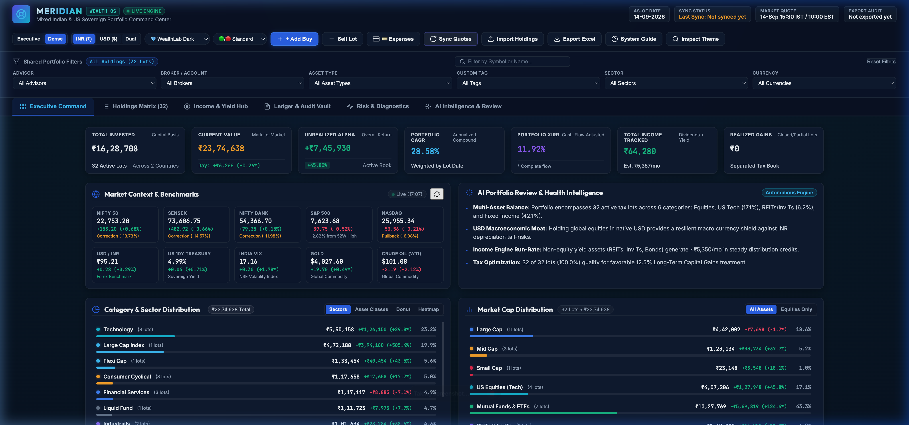
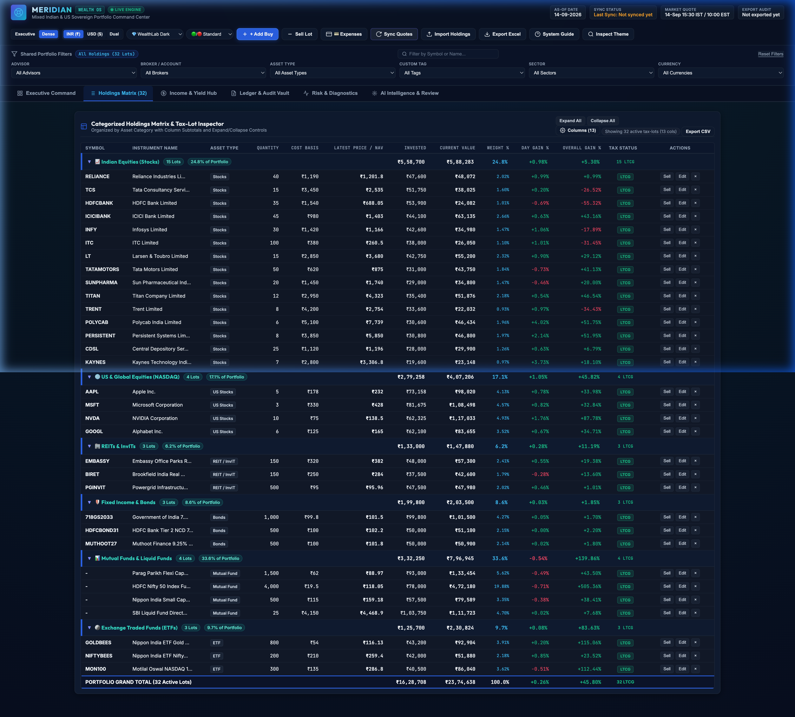
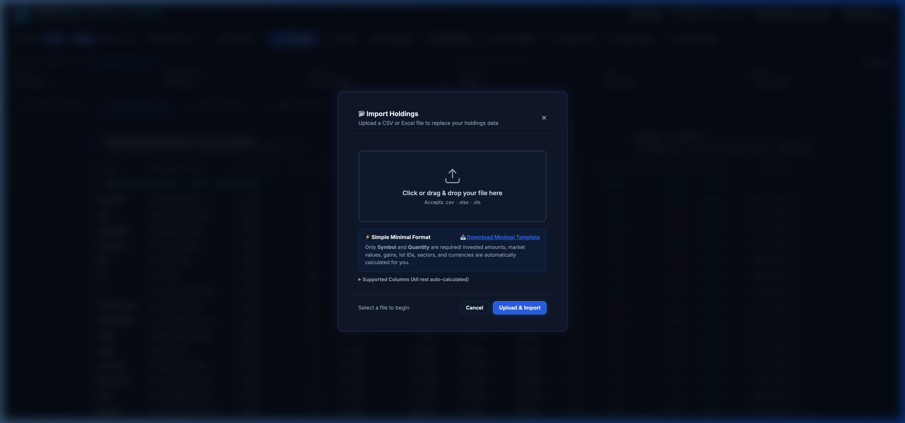

# Meridian Wealth OS — Executive Multi-Asset Portfolio Command Center

[](https://python.org)
[](https://flask.palletsprojects.com)
[](#license)

An institutional-grade, multi-currency portfolio command center designed for active investors, family offices, and wealth managers. Tracks Indian Equities (NSE/BSE), US/Global Stocks (NASDAQ/NYSE), Mutual Funds (AMFI), Fixed Income (Sovereign G-Secs, Corporate Bonds, NCDs), REITs, InvITs, and Commodity ETFs in a unified, executive cockpit.

---

## 📸 User Interface & Previews

### Executive Command Cockpit


### Multi-Asset Holdings Matrix & Tax-Lot Inspector


### Minimal Drag-and-Drop Importer & Template Engine
<p align="center">
  
</p>

---

## ⚡ Highlights & Key Capabilities

- **📂 Drag-and-Drop Import**: Directly upload your holdings via `.csv` or `.xlsx` from the browser. Automatically generates Lot IDs, calculates invested amounts, and normalizes columns. Includes a pre-configured template download.
- **🔄 Live Market Synchronization**: Parallel real-time price & NAV fetching from **Yahoo Finance** (Equities, ETFs, USD/INR) and **AMFI** (Indian Mutual Funds).
- **💵 Native Multi-Currency Accounting**: Real-time USD to INR conversion with cost-basis tracking for overseas holdings.
- **🤖 Multi-Agent AI Investment Committee**: 4-agent institutional advisory panel (Growth & Alpha Specialist, Chief Risk Officer, Family Tax Strategist, and CIO Lead Arbiter) powered by OpenRouter or local heuristic simulation.
- **🎨 Executive UI & Color Themes**: Bespoke dark & light themes (*Obsidian Slate*, *Classic Light*, *Terminal Green*) with real-time KPI command strips, asset allocation sunbursts, and sector concentration heatmaps.
- **📊 Institutional Analytics**: XIRR calculation, LTCG vs STCG tax lot breakdown, 52-week high distance, dividend yields, and one-click Excel workbook export.

---

## 🚀 Quickstart Guide

### 1. Clone & Set Up Virtual Environment

```bash
# Clone the repository
git clone https://github.com/sridhar1brs/portfolio-dashboard-demo.git
cd portfolio-dashboard-demo

# Create and activate python virtual environment
python3 -m venv venv
source venv/bin/activate   # On Windows: venv\Scripts\activate

# Install required dependencies
pip install -r requirements.txt
```

### 2. Configure Environment (Optional)

```bash
cp .env.example .env
```
*Note: The AI Committee works out-of-the-box with heuristic simulation. To connect live LLM models, add your free [OpenRouter API key](https://openrouter.ai/keys) to `.env`.*

### 3. Launch the Dashboard

```bash
python3 app.py
```
Open **[http://127.0.0.1:5151](http://127.0.0.1:5151)** in your browser.

---

## 📂 Importing Your Holdings

1. Open the dashboard and click the **"Import Holdings"** button in the top navigation bar.
2. Click **"Download Sample Template"** to get a formatted CSV with examples across all asset classes.
3. Fill in your holdings. At minimum, only three columns are required:
   - `Name` (e.g. `Reliance Industries`, `Apple Inc.`, `Parag Parikh Flexi Cap`)
   - `Asset Type` (`Stocks`, `US Stocks`, `Mutual Fund`, `Bonds`, `REIT`, `ETF`)
   - `Quantity` (e.g. `25`)
   - `Inv. Price` (e.g. `1450.00`)
4. Drag and drop your `.csv` or `.xlsx` into the modal and click **"Upload & Import"**. The dashboard will validate, normalize, and load your positions instantly.
5. Click **"Sync Quotes"** anytime to refresh live prices from NSE/BSE, NASDAQ, and AMFI.

---

## 🧱 Project Structure

```
├── app.py                      # Flask backend API & endpoints
├── index.html                  # Single-page executive dashboard UI
├── app.js                      # Core reactive frontend logic & state engine
├── style.css                   # Custom responsive styling and theme tokens
├── requirements.txt            # Python dependencies (Flask, pandas, openpyxl, yfinance)
├── .env.example                # Sample environment configuration
├── data/                       # Local data storage
│   ├── holdings.csv            # Master canonical holdings dataset
│   ├── tags.csv                # Custom asset tags, owners, and accounts
│   ├── expenses.csv            # Wealth management fee ledger
│   └── transactions.csv        # Historical buy/sell ledger
├── templates/
│   └── index.html              # Template source file
└── scripts/
    ├── live_prices.py          # Parallel quote fetcher (Yahoo Finance + AMFI)
    ├── portfolio_metrics.py    # Math engine for totals, P&L, returns, and XIRR
    ├── ai_committee.py         # Multi-agent AI investment committee
    ├── build_portfolio_csv.py  # Data reconciler and Excel generator
    └── export_portfolio_workbook.py # Excel workbook generator
```

---

## 🛡️ Privacy & Local-First Philosophy

All your portfolio holdings and financial records stay **100% on your local machine** inside `data/holdings.csv`. No financial telemetry, cookies, or trade logs are ever sent to external third parties.

---

## 📄 License

MIT License. Free for personal, commercial, and educational use.
